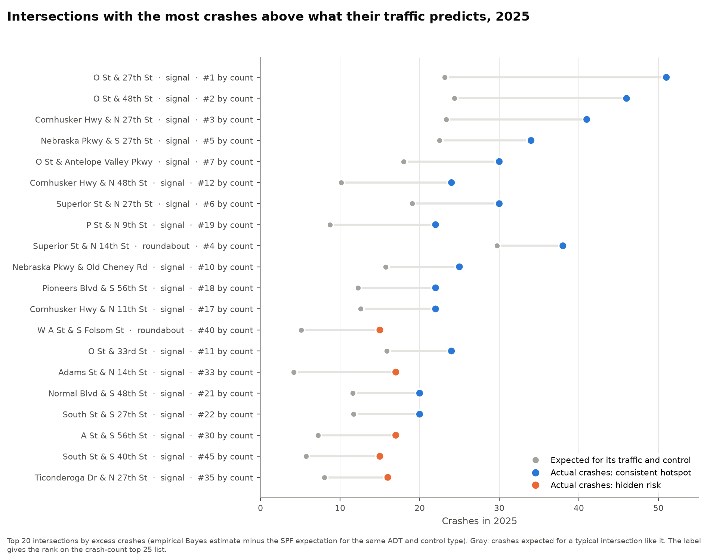
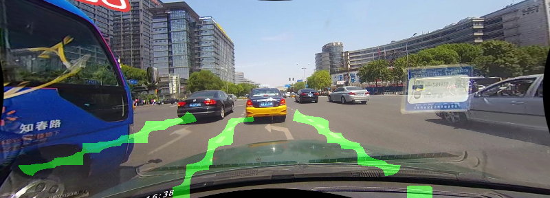

# Cooper Malone · Project Portfolio

Data science, statistics and machine learning projects from my work at the University of Nebraska–Lincoln. Each folder has the source code, the results and a write-up. Start with the project README; the full paper or report is linked from it.

| Project | What it is | Headline result | Stack |
|---|---|---|---|
| [**Vision Zero Crash Analysis**](./vision-zero-crash-analysis) | Checks whether the patterns behind Lincoln, NE's traffic-safety plan still hold, using all 6,776 crashes from 2025. Work for the City of Lincoln. | Pedestrians were in **20.6%** of fatal/serious-injury crashes, nearly double the plan's 11.0% (p = 0.003). Also found **8 high-risk intersections** that a raw crash count misses. | Python, pandas, SciPy, Folium, Matplotlib |
| [**Lane Marker Detection**](./lane-marker-detection) | A Spatial CNN (ResNet-18 backbone) that segments lane markings in CULane driving images, trained on a GPU cluster. | Best validation **F1 = 0.441**, IoU = 0.297. Showed that **44× more training data didn't help** and traced the plateau to the model's stride-32 output resolution. | PyTorch, CUDA/AMP, SLURM, OpenCV |
| [**Adaptive Chunk-Based Compression**](./adaptive-chunk-compression) | Integer codecs for search-engine posting lists (vByte, Elias gamma, bit packing), plus an adaptive scheme that picks the best codec for each chunk. | **49% smaller** than the best fixed codec on lists that mix gap patterns. On real text the per-chunk codec IDs cost more than they save, and the paper works out why. | Python, pytest (98 tests), uv |

---

## Vision Zero Crash Analysis
**Team of 3 · client: City of Lincoln · in progress**

The City of Lincoln gave our team its full 2025 crash records. The question was whether its *Vision Zero Action Plan*, built on 2014–2023 data, still describes the city's streets. I wrote the analysis pipeline:

- **Hypothesis tests** (binomial and Poisson) of seven of the plan's headline statistics against 2025.
- **Safety performance functions** fit by maximum likelihood to a zero-truncated negative binomial, then **empirical Bayes** estimates to rank 925 intersections by excess crashes for their traffic volume.
- **Singular value decomposition** of crash conditions (weather, light, time of day) at the 47 highest-crash locations.
- An **[interactive crash map](https://coopermalone.github.io/project_portfolio/vision-zero-crash-analysis/figures/crash_map.html)** for City staff, filterable by severity, travel mode, date, light and time of day. Website for the map: https://vision-zero-crash-analysis-map.netlify.app/

## Lane Marker Detection
**Individual project**

- Implemented a Spatial CNN, which passes messages row by row and column by column so that lane lines stay continuous where they're hidden.
- Trained in two phases on a V100 GPU with SLURM and mixed precision: 48 epochs on a 2k-image subset, then 48 more on the full 88,880-image CULane training set.
- Found that the extra data never beat the subset's epoch-12 peak. Traced the plateau to message passing on a 9×25 feature grid, which can't draw lines a few pixels wide.

## Adaptive Chunk-Based Compression
**Individual project**

- Implemented vByte, Elias gamma and bit-packing encoders and decoders from scratch, using bit-level buffered writes.
- Built an adaptive compressor that encodes each chunk of a posting list with every codec, keeps the smallest, and stores a codec ID.
- Benchmarked on synthetic gap patterns and a positional index of Shakespeare, separating the benefit of chunking from the benefit of choosing a codec.
- On mixed-pattern lists, adaptive was 49% smaller than any fixed codec. On real text, 52% of terms occur once, so the codec IDs outweigh the savings; entropy-coding them would turn that into a small gain.

---

## Skills shown

- **Statistics:** hypothesis testing, count models (Poisson, negative binomial), maximum likelihood, empirical Bayes, SVD/PCA, multiple-comparison control
- **Machine learning:** CNN segmentation, transfer learning, mixed-precision training, model evaluation (IoU, F1), diagnosing why a model plateaus
- **Engineering:** reproducible script pipelines, unit testing, HPC job scheduling, algorithm implementation at the bit level
- **Communication:** technical reports, interactive maps and charts for a non-technical client

## Contact

Cooper Malone · [coopercruz2004@gmail.com](mailto:coopercruz2004@gmail.com)
