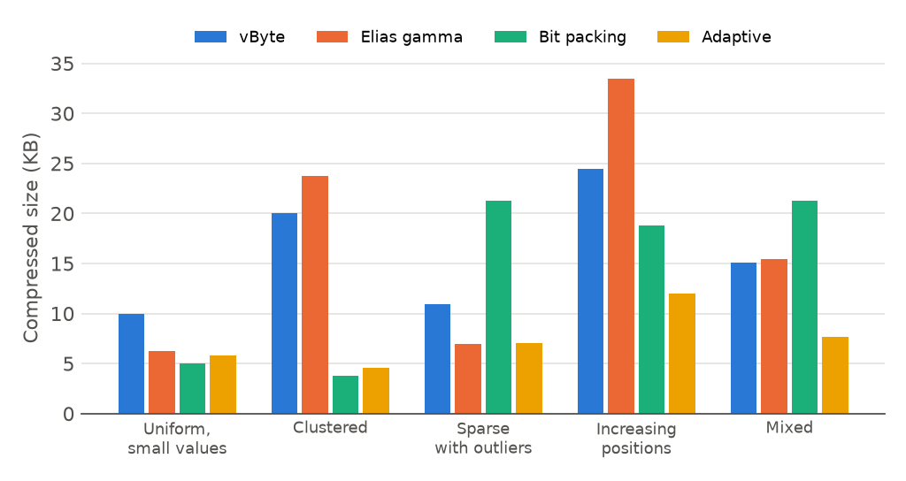

# Adaptive Chunk-Based Compression for Inverted Index Posting Lists

**University of Nebraska–Lincoln · individual project** · [Full paper (PDF)](./report.pdf)

Search engines store, for every term, a *posting list*: the sorted IDs or positions where the term occurs. These lists are stored as gaps between consecutive entries, and the gaps are compressed, usually with one codec for the whole index. But real lists mix dense runs of small gaps with sparse stretches of large ones, and no single codec suits both.

This project implements three integer codecs from scratch (vByte, Elias gamma and bit packing) and an **adaptive** scheme. It splits each list into chunks, encodes each chunk with every codec, keeps the smallest result, and stores a 1-byte codec ID with it.

## Results

### When a list mixes patterns, adaptive wins by a lot



Compressed size in bytes of 10,000-integer synthetic lists (lower is better; fixed random seed, chunks of 128):

| Dataset | vByte | Elias gamma | Bit packing | Best codec, chunked | **Adaptive** |
|---|---:|---:|---:|---:|---:|
| Uniform, small values | 10,000 | 6,238 | **5,009** | 5,711 | 5,781 |
| Clustered | 20,000 | 23,750 | **3,759** | 4,461 | 4,540 |
| Sparse with outliers | 10,978 | **6,982** | 21,259 | 7,012 | 7,091 |
| Increasing positions | 24,452 | 33,509 | 18,759 | **11,955** | 12,034 |
| **Mixed** (all four patterns in one list) | 15,083 | 15,415 | 21,259 | 10,749 | **7,647** |

- **Mixed list:** adaptive is **49% smaller** than the best codec applied to the whole list, and 29% smaller than the best single codec applied chunk by chunk. This is the case per-chunk selection is designed for.
- **Single-pattern lists:** adaptive is never best, but it stays within 2% of the best codec at the same chunk size (the gap is its 79 codec IDs), without having to know that codec in advance.

### On real text, the codec IDs cost more than adaptivity saves

On a positional index of Shakespeare's complete works (901k tokens, 59.5k terms), **vByte compresses best** at every chunk size, to about 45% of the original size. Adaptive picks vByte for 98% of chunks. Half the terms occur only once, so there are over 60,000 tiny chunks, and storing one byte per chunk makes the adaptive index **3–4% larger** than plain vByte. Even an ideal 2-bit ID still loses.

The paper estimates that entropy-coding the IDs (about 0.15 bits per chunk) would reverse this, for a 0.2–0.6% gain over vByte. That points to the real design problem: keep the cost of each decision far below what it saves.

### Cost: about 6 times slower to compress

Compressing the full index took 1.81 s with adaptive against 0.31 s with vByte (pure Python). Decompression isn't affected, because each chunk is decoded once with its stored codec.

## How it works

| Codec | Idea | File |
|---|---|---|
| **vByte** | 7 data bits per byte; the high bit marks whether more bytes follow | [`compression/vByte.py`](./compression/vByte.py) |
| **Elias gamma** | Unary length prefix plus binary suffix, written as one continuous bitstream across byte boundaries | [`compression/elias.py`](./compression/elias.py) |
| **Bit packing** | Subtract the block minimum, then pack every value at the smallest width that fits the largest; 9-byte header | [`compression/bitPacking.py`](./compression/bitPacking.py) |
| **Fixed chunking** | Split a list into equal blocks and compress each independently, which allows partial decoding | [`chunk/fixedChunk.py`](./chunk/fixedChunk.py) |
| **Adaptive** | For each chunk, try every codec, keep the smallest, and store a 1-byte codec ID | [`chunk/adaptiveChunk.py`](./chunk/adaptiveChunk.py) |

## Running it

Requires Python 3.12+ and [uv](https://docs.astral.sh/uv/).

```bash
git clone https://github.com/CooperMalone/project_portfolio.git
cd project_portfolio/adaptive-chunk-compression
uv sync

uv run python main.py          # synthetic benchmark (no downloads needed)
uv run python -m pytest        # 98 unit tests, round-trip correctness for every codec
```

To reproduce every number and figure in the paper, put [`t8.shakespeare.txt`](https://ocw.mit.edu/ans7870/6/6.006/s08/lecturenotes/files/t8.shakespeare.txt) in `data/` and run:

```bash
uv run --with matplotlib python report/make_figures.py   # writes report/results.json and report/figures/
```

The paper's LaTeX source is in [`report/report.tex`](./report/report.tex).

## Structure

```text
adaptive-chunk-compression/
├── compression/   # vByte, Elias gamma, bit packing, adaptive compressor
├── chunk/         # fixed and adaptive chunking
├── comparisons/   # benchmark scripts (synthetic and real text)
├── utils/         # posting-list construction, data loading, timing
├── tests/         # pytest suite
├── report/        # paper source, figure script, results.json, figures
├── main.py        # entry point (synthetic benchmark)
└── report.pdf     # the paper
```
