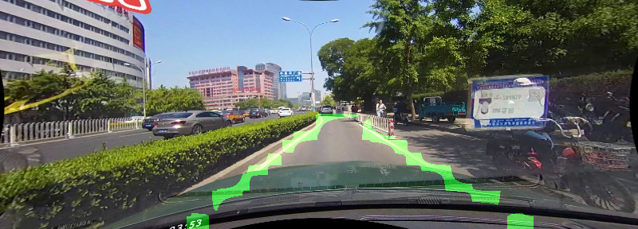
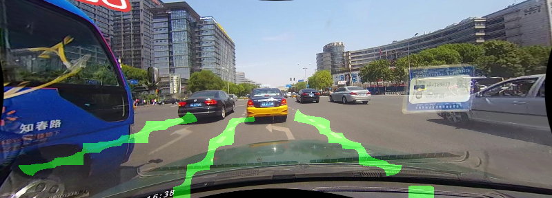

# Lane Marker Detection with a Spatial CNN

**University of Nebraska–Lincoln · individual project** · [Full report (PDF)](./report.pdf)

Lane detection is basic to driver-assistance and self-driving systems. Lane markings are a hard target for segmentation: they are thin, long, and often hidden by traffic, shadows or glare. This project implements a **Spatial CNN (SCNN)** (Pan et al., AAAI 2018) on an ImageNet-pretrained **ResNet-18**. SCNN passes messages slice by slice across the rows and columns of the feature map, so a lane can stay continuous where part of it is hidden. The model is trained on the **CULane** dataset to predict a binary lane mask, on a V100 GPU through SLURM.

## Results

Both phases are scored on the full CULane validation set (9,675 images):

| Phase | Epochs | Training images | Best IoU | Best F1 | Validation loss |
|---|:---:|---:|:---:|:---:|:---:|
| 1. Subset | 1–48 | ~2,000 | **0.297** (epoch 12) | **0.441** (epoch 12) | 0.74 → 0.93 |
| 2. Full dataset | 49–96 | 88,880 | 0.295 (epoch 76) | 0.437 (epoch 76) | 0.86–1.12, rising |

 

**44 times more data didn't help.** The model hit its best score after 12 epochs on 2,000 images. Forty-eight more epochs on the full 88,880-image set never beat it, and validation loss kept rising while IoU and F1 stayed flat. Together these point to overfitting, and to a limit in the model rather than the data.

**Diagnosis: output resolution.** Message passing and the prediction head run on ResNet-18's stride-32 feature map, a 9×25 grid where each cell covers 32×32 pixels. That map is then upsampled 32 times. The model finds the lanes, but it can't draw a line a few pixels wide, so its masks are much wider than the painted markings (see above), and the extra width caps IoU. The original SCNN runs at stride 8 with 9-cell-wide kernels.

**Failure cases:** glare and haze on the windshield wash out the markings and break up the predicted lanes. The model also produces recurring false positives on the car's hood.

**Next steps:**
1. Compute features at stride 8 (dilated ResNet stages or an FPN decoder).
2. Predict each lane in its own channel and score with the official CULane evaluator.
3. Add brightness and glare augmentation.
4. Save optimizer state in checkpoints and add a learning-rate schedule.

> These are pixel-level scores on a binary mask. They aren't comparable to the lane-level CULane F1 that published methods report.

## Setup

| | |
|---|---|
| Model | ResNet-18 (stride 32) → 3×3 conv to 128 channels → SCNN message passing in 4 directions (shared 1×1 kernel) → 3×3 refine → 1×1 head → ×32 bilinear upsample |
| Input | 288×800, ImageNet normalization, 50% horizontal flip |
| Loss | Binary cross-entropy + Dice |
| Optimizer | AdamW, learning rate 1e-3, weight decay 1e-4, batch size 8 |
| Infrastructure | PyTorch, CUDA, automatic mixed precision, NVIDIA V100 32 GB, SLURM batch jobs |
| Metrics | Per-image IoU and F1 of lane pixels (threshold 0.5), averaged over the validation set |

## Code

```text
lane-marker-detection/
├── models/
│   ├── backbone.py        # ResNet-18 encoder
│   └── scnn.py            # SCNN message passing and segmentation head
├── datasets/
│   └── tusimple.py        # image/mask dataset loader, used here for CULane
├── utils/
│   ├── metrics.py         # BCE + Dice loss, IoU, F1
│   └── visualize.py       # prediction overlays
├── plots/                 # Phase 1 metrics, recomputed on the full validation set
├── report/                # LaTeX source, figure script and figures for report.pdf
├── config.py              # hyperparameters and paths
├── train.py               # training loop with AMP and checkpointing
├── eval.py                # validation loop
├── info.py                # re-evaluates saved checkpoints
├── predict_single.py      # inference and overlay for one image
├── run_train_48.sbatch    # SLURM job script
├── requirements.txt
└── report.pdf             # full report
```

> Paths in `config.py`, `info.py`, `predict_single.py` and the SLURM script point to the university cluster. Change them to run elsewhere. The CULane dataset and the model checkpoints are not included.
