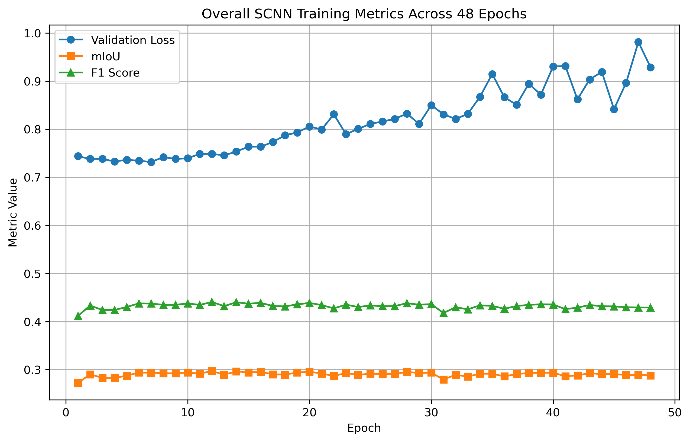

# Lane Marker Detection with a Spatial CNN

**University of Nebraska–Lincoln · individual project** · [Full report (PDF)](./report.pdf)

Lane detection is basic to driver-assistance and self-driving systems. Lane markings are a hard target for segmentation: they are thin, long, and often hidden by traffic, shadows or glare. This project implements a **Spatial CNN (SCNN)** (Pan et al., AAAI 2018) with an ImageNet-pretrained **ResNet-18** backbone. SCNN passes information slice by slice along the rows and columns of the feature map, so a lane line stays continuous even where part of it can't be seen. The model is trained on the **CULane** benchmark.

## Results

Training ran in two phases on UNL's Swan GPU cluster:

| Phase | Epochs | Training data | Validation mIoU | Validation F1 |
|---|:---:|---|:---:|:---:|
| 1. Pipeline validation | 1–48 | CULane subset (~2,000 train / 500 val images) | 0.290 | 0.430 |
| 2. Full-scale training | 49–96 | Full CULane (~88,000 train / 9,600 val images) | **0.295** (best, epoch 76) | **0.437** (best, epoch 76) |



**What the curves show.** On the 2k-image subset, mIoU and F1 level off by about epoch 6, while validation loss rises from 0.74 to 0.93. The model was overfitting the small subset, which is why training moved to the full dataset. On the full set, mIoU stayed between 0.286 and 0.295 and F1 between 0.426 and 0.437, a small but steady gain. For reference, the original SCNN paper reports about 0.30–0.35 mIoU on CULane.

**Where it fails.** Predicted masks are thin and continuous on ordinary highway and urban scenes. The model misses or breaks up lanes where windshield glare saturates the image or a large vehicle covers the markings. The report shows examples of both successes and failures.

**What I'd do next:** train at a higher resolution than 288×800, add brightness and contrast augmentation (the only augmentation used was a horizontal flip), and try glare-robust architectures.

## Setup

| | |
|---|---|
| Model | ResNet-18 encoder → SCNN row/column message passing → refinement block → 1×1 conv head (binary lane mask) |
| Input | 288×800, ImageNet normalization, 50% horizontal flip |
| Loss | Binary cross-entropy + Dice |
| Optimizer | AdamW, lr 1e-4, weight decay 1e-5, batch size 8 |
| Infrastructure | PyTorch, CUDA, automatic mixed precision (AMP), SLURM batch jobs |
| Metrics | Mean IoU and pixel-level F1, computed on the validation set after every epoch |

## Code

```text
lane-marker-detection/
├── models/
│   ├── backbone.py        # ResNet-18 encoder
│   └── scnn.py            # SCNN message-passing layers and segmentation head
├── datasets/
│   └── tusimple.py        # image/mask dataset loader, used here for CULane
├── utils/
│   ├── metrics.py         # BCE + Dice loss, mIoU, F1
│   └── visualize.py       # prediction overlays
├── plots/                 # per-epoch validation metrics (epochs 1–48) and CSV
├── config.py              # hyperparameters and paths
├── train.py               # training loop with AMP and checkpointing
├── eval.py                # validation loop
├── info.py                # recomputes metrics across saved checkpoints
├── predict_single.py      # inference and overlay for one image
├── run_train_48.sbatch    # SLURM job script
├── requirements.txt
└── report.pdf             # full report (all project milestones)
```

> Paths in `config.py`, `info.py`, `predict_single.py` and the SLURM script point to the university cluster. Change them to run elsewhere. The CULane dataset and the model checkpoints are not included.
