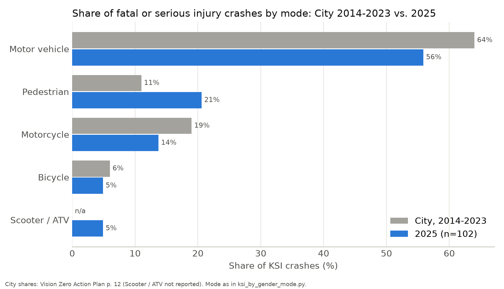
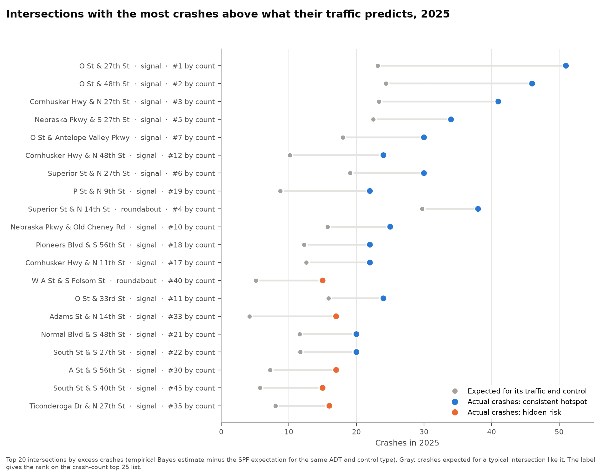
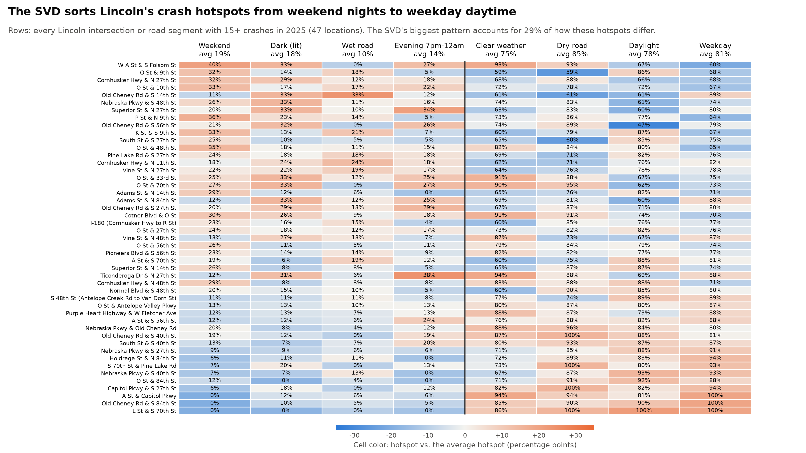
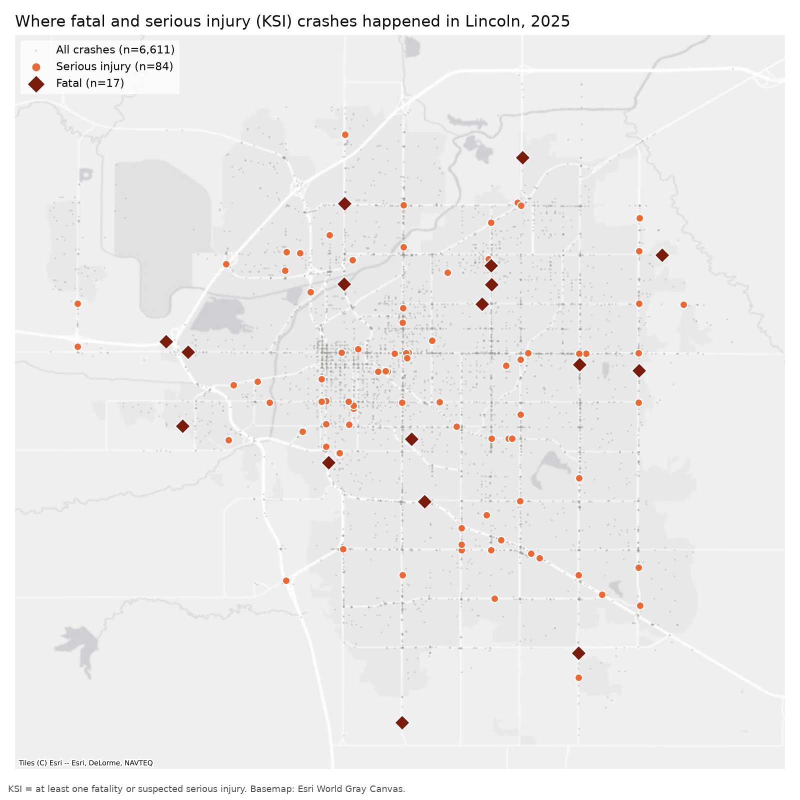

# Do the Patterns Behind Lincoln's Vision Zero Plan Hold in 2025?

**University of Nebraska–Lincoln**
Team: Cooper Malone, Linda Ngo, Sophia Thompson · Client: City of Lincoln, NE
Status: analysis complete; final report in progress

In March 2026 the City of Lincoln adopted the *Safe Streets Lincoln Vision Zero Action Plan*. Its goal is zero traffic deaths and serious injuries, and its priorities rest on crashes from 2014–2023. The City gave our team the complete record of the **6,776 crashes reported in Lincoln in 2025** (137 fields per crash) and asked one question: **if the analysis is redone with 2025 data, do the patterns, rankings or recommendations change in a meaningful way?**

The analysis centers on **KSI crashes**, those in which someone was **k**illed or **s**eriously **i**njured. There were 102 in 2025.

**▶ [Open the interactive crash map](https://coopermalone.github.io/project_portfolio/vision-zero-crash-analysis/figures/crash_map.html)**. You can also download [`figures/crash_map.html`](./figures/crash_map.html) and open it in any browser.

---

## Key findings

### 1. Pedestrians make up a much larger share of serious crashes than the plan assumes

Each 2025 statistic was tested against the plan's 10-year value. The test asks how likely a 2025 result this far from the plan's value would be if nothing had changed.

| Plan statistic (2014–2023) | Plan | 2025 | p-value | |
|---|---:|---:|---:|---|
| KSI crashes per year | 130.5 | 102 | 0.006 | **fewer** (Poisson test) |
| KSI crashes involving a pedestrian | 11.0% | 20.6% | 0.003 | **nearly double** |
| KSI crashes with a male road user | 60.4% | 72.3% | 0.011 | higher, borderline |
| KSI crashes involving a motorcyclist | 19.0% | 13.7% | 0.11 | within normal variation |
| KSI crashes involving a bicyclist | 6.0% | 4.9% | 0.42 | within normal variation |
| KSI crashes on the High Risk Network | 58.1% | 52.0% | 0.12 | within normal variation |
| KSI crashes at signalized intersections | 55.5% | 30.4%* | <0.001 | depends on definition* |

Seven tests are run, so the strict threshold is a Bonferroni-corrected 0.05 / 7 ≈ 0.007. The pedestrian share and the drop in the annual KSI count pass it. \*The plan doesn't say whether 55.5% is a share of *all* KSI crashes or of KSI crashes *at intersections*. The 2025 figure is 30.4% under the first reading and 49.2% under the second, and we have asked the City which one the plan uses.



### 2. A crash-count ranking misses some dangerous intersections

A busy intersection has more crashes simply because more cars go through it. To correct for this, I fit a **safety performance function** for each control type (signal, roundabout, stop/yield) to 925 intersections. Each function gives the crashes expected for a typical intersection with the same traffic. I then ranked intersections by **excess crashes**, an empirical Bayes estimate minus that expectation.

Of the top 25 intersections by excess, **17 also rank in the top 25 by crash count**; these are consistent hotspots. The other **8 are "hidden risks"**: intersections ranked as low as #91 by crash count whose estimated crash frequency is 1.6 to 5 times what their traffic predicts.



### 3. Hotspots split into "weekend nights" and "weekday daytime" locations

An SVD of the 47 locations with 15 or more crashes describes each by when its crashes happen (weather, road surface, light, time of day, day of week). The largest pattern explains 29% of the variation between hotspots. It sorts them from weekend, after-dark crash locations (W A St & S Folsom St, O St & 9th St) to weekday, daylight ones (L St & S 70th St).



### 4. Where KSI crashes happened



---

## Methods

| Question | Method | Script |
|---|---|---|
| Do the plan's statistics still hold? | One-sided **binomial** tests for shares, a **Poisson** test for the annual count, and Bonferroni correction across 7 tests | [`city_comparison_tests.py`](./analysis/city_comparison_tests.py), [`ksi_share_by_mode.py`](./analysis/ksi_share_by_mode.py), [`ksi_by_gender_mode.py`](./analysis/ksi_by_gender_mode.py), [`signalized_ksi.py`](./analysis/signalized_ksi.py) |
| Does the plan's High Risk Network still capture KSI crashes? | Rebuilt the plan's risk scoring from the fields in the data: road class, ADT, and control or lanes, scored 0–8 and split into High, Moderate and Low tiers | [`high_risk_network.py`](./analysis/high_risk_network.py), [`high_risk_network_scoring.py`](./analysis/high_risk_network_scoring.py) |
| Which intersections are riskier than their traffic explains? | Safety performance functions μ = e<sup>a</sup>·ADT<sup>b</sup>, fit by **maximum likelihood** to a **zero-truncated negative binomial**, since intersections with no crashes are missing from the data. **Empirical Bayes** shrinkage (Highway Safety Manual) guards against regression to the mean | [`adt_rates.py`](./analysis/adt_rates.py) |
| Do hotspots differ in *when* crashes happen? | Matrix of 47 locations × 18 condition shares, centered and with each group rescaled to equal weight, then a **singular value decomposition**. Scores are checked against KSI share with Spearman correlation | [`conditions_svd.py`](./analysis/conditions_svd.py) |
| Where are crashes concentrated? | Static maps and rankings, plus an interactive **Folium/Leaflet** map with heat map, KSI markers, a top-25 list and High Risk Network tiers. It filters by severity, mode, date, light and time of day, and links to Street View | [`crash_map.py`](./analysis/crash_map.py) |

**Data cleaning** followed written guidance from City staff. The main decisions:
- 552 unknown crash times were left out of the time-of-day analyses only.
- 165 crashes with missing or invalid coordinates were left off the maps but kept in citywide totals; 4 swapped latitude/longitude pairs were corrected.
- 406 intersections whose traffic count looked like a placeholder were left out of the traffic-adjusted ranking.
- When drivers' conditions disagreed, one condition per crash was assigned by the City's rule.

The full list is in the [data dictionary](./DATA_DICTIONARY.md).

## My role

I wrote the Python analysis pipeline in this folder: the hypothesis tests, the High Risk Network rebuild, the traffic-adjusted ranking, the SVD, and the static and interactive maps. I also wrote the data dictionary. Linda Ngo and Sophia Thompson made the driver, weather and light condition analysis (in R, not included here), and all three of us are writing the report.

## Reproducing

The crash records came from the City of Lincoln and are **not included** in this repository. With the spreadsheet saved as `2025CrashData.xlsx` in this folder, each script rebuilds its outputs in `figures/`:

```bash
cd vision-zero-crash-analysis
uv run --with pandas --with openpyxl --with matplotlib --with contextily --with folium --with scipy python analysis/crash_map.py
```

Every script lists its exact `uv run` command in its docstring.

## Structure

```text
vision-zero-crash-analysis/
├── analysis/             # one script per question (see Methods)
├── figures/              # every chart, table (CSV) and the interactive map
│   └── crash_map.html    # interactive map: open in a browser
└── DATA_DICTIONARY.md    # the 25 fields used, code lists, cleaning guidance from the City
```
